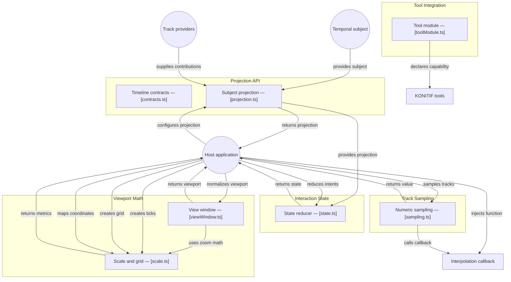

# GitDiagram architecture — @konitif/timeline

This architecture view was generated from the public repository by [GitDiagram](https://gitdiagram.com/lemouf/konitif-timeline) on 2026-09-20 18:45:41 UTC.

It is a documentation projection of the repository tree, README, and source files sampled by GitDiagram. It does not replace the authored contracts in [catalog.json](catalog.json) and [diagrams.json](diagrams.json), nor does it establish runtime authority.

The Mermaid source keeps GitDiagram's groups, nodes, relationships, and source links. GitDiagram's forced color classes and HTML line breaks are omitted so the diagram remains readable in local previews and dark themes.

- Public repository: [konitif-timeline](https://github.com/LeMouf/konitif-timeline)
- Interactive diagram: [Open in GitDiagram](https://gitdiagram.com/lemouf/konitif-timeline)

## Architecture diagram

## Generated analysis

@konitif/timeline is a headless temporal projection library. A host supplies a caller-owned subject and versioned track contributions; the projection normalizes tracks and duration, after which the host creates interaction state, viewport calculations, scale/grid data, and numeric samples. State intents are reduced deterministically, while viewport and scale functions calculate scrubbing, zoom, ticks, and coordinates. The tool declaration exposes the capability to KONITIF tooling. This map reflects the sampled runtime source and README; unsampled consumers are not inferred.
